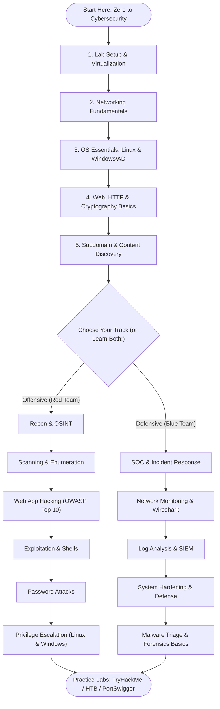

# Cybersecurity & Ethical Hacking Roadmap (Kali Linux Quick-Ref & Study Guide)

> [!CAUTION]
> **Educational & Authorized Use Only**
> Every tool, command, and technique documented in this repository is intended strictly for **educational purposes**, **authorized penetration testing**, **defensive security engineering**, and **legal lab/CTF environments**. Never run offensive scans or exploits against systems you do not own or lack explicit written permission to test.

Welcome to the **Kali Linux-Focused Zero-to-Intermediate Cybersecurity Roadmap**. This repository is designed as a **dual-purpose guide**:
1. **A structured learning path** taking you from Kali Linux & networking fundamentals to practical Red Team (Offensive) and Blue Team (Defensive) workflows.
2. **A detailed quick-reference cheatsheet** with verified **Kali Linux CLI commands**, `/usr/share/` wordlist & resource paths, mental models, diagrams, detection notes, and hands-on lab recommendations.

### Kali Linux Quick-Start (First 5 Minutes)
```bash
# 1. Update Kali and install essential wordlists & tools
sudo apt update && sudo apt full-upgrade -y
sudo apt install -y seclists rlwrap tmux jq

# 2. Extract rockyou.txt (required by ffuf, hydra, john, hashcat)
sudo gzip -d /usr/share/wordlists/rockyou.txt.gz

# 3. Check your lab VPN IP (tun0) when connected to TryHackMe / Hack The Box
ip -4 addr show tun0
```

---

## Visual Learning Roadmap



---

## Curriculum Index

### Phase 1: Common Foundations (`learnings/common/`)
Build the core technical literacy every security practitioner needs—whether attacking or defending.

| # | Topic | Level | What You'll Master | Guide |
|---|-------|-------|--------------------|-------|
| 1 | **Lab Setup & Virtualization** | Beginner | VirtualBox/VMware, Kali Linux, isolated NAT/Host-Only networks, snapshots | [lab_setup_and_virtualization.md](learnings/common/lab_setup_and_virtualization.md) |
| 2 | **Networking Fundamentals** | Beginner | OSI/TCP-IP, subnetting, TCP handshake, common ports, `dig`, `ss`, `tcpdump` | [networking_fundamentals.md](learnings/common/networking_fundamentals.md) |
| 3 | **Linux & Bash Essentials** | Beginner | Permissions/SUID, `/var/log`, `grep`/`awk`/`sed`, `systemctl`, Bash basics | [linux_and_bash_essentials.md](learnings/common/linux_and_bash_essentials.md) |
| 4 | **Windows & Active Directory** | Beginner–Int | Registry, Event Logs, PowerShell, AD Forests/GPOs, Kerberos vs. NTLM | [windows_and_active_directory_basics.md](learnings/common/windows_and_active_directory_basics.md) |
| 5 | **Web & HTTP Fundamentals** | Beginner | HTTP anatomy, status codes, cookies/JWT, TLS, CORS, `curl` & Burp basics | [web_and_http_fundamentals.md](learnings/common/web_and_http_fundamentals.md) |
| 6 | **Cryptography Basics** | Beginner | Encoding vs. Hashing vs. Encryption, AES, RSA, PKI, `openssl`, `gpg` | [cryptography_basics.md](learnings/common/cryptography_basics.md) |
| 7 | **Finding Subdomains & Paths** | Beginner–Int | Passive/active subdomain enum (`subfinder`, `amass`), fuzzing (`ffuf`, `gobuster`) | [finding_subdomain.md](learnings/common/finding_subdomain.md) |

---

### Phase 2A: Offensive Track (`learnings/offensive/`)
Structured around the **Penetration Testing Execution Standard (PTES)**—from reconnaissance to privilege escalation.

| # | Topic | Level | What You'll Master | Guide |
|---|-------|-------|--------------------|-------|
| 1 | **Reconnaissance & OSINT** | Beginner–Int | Google Dorking, Shodan, `crt.sh`, `theHarvester`, `exiftool` | [recon_and_osint.md](learnings/offensive/recon_and_osint.md) |
| 2 | **Scanning & Enumeration** | Beginner–Int | `nmap` scan types & NSE scripts, SMB/SNMP/FTP/HTTP enum, `nuclei` | [scanning_and_enumeration.md](learnings/offensive/scanning_and_enumeration.md) |
| 3 | **Web App Hacking (OWASP)** | Intermediate | IDOR, SQLi (`sqlmap`), XSS, CSRF, SSRF, Command Injection, Burp Suite | [web_app_hacking_owasp.md](learnings/offensive/web_app_hacking_owasp.md) |
| 4 | **Exploitation & Shells** | Intermediate | `searchsploit`, Metasploit, reverse/bind shells, TTY upgrades, file transfers | [exploitation_and_shells.md](learnings/offensive/exploitation_and_shells.md) |
| 5 | **Password Attacks** | Intermediate | Online spraying (`hydra`, `netexec`), offline cracking (`hashcat`, `john`) | [password_attacks.md](learnings/offensive/password_attacks.md) |
| 6 | **Privilege Escalation** | Intermediate | Linux (`sudo -l`, SUID, cron, `linpeas`) & Windows (Tokens, Services, `winpeas`) | [privilege_escalation.md](learnings/offensive/privilege_escalation.md) |
| 7 | **Wi-Fi & Wireless Attacks** | Intermediate | Monitor mode, WPA2 4-way handshake/PMKID, WPS Pixie Dust, `aircrack-ng`, `wifite` | [wifi_attacks.md](learnings/offensive/wifi_attacks.md) |
| 8 | **Wi-Fi Evil Twin Simulation** | Intermediate | Rogue AP theory, `hostapd` + `dnsmasq` lab simulation, WIPS & 802.11w defense | [wifi_evil_twin.md](learnings/offensive/wifi_evil_twin.md) |

---

### Phase 2B: Defensive Track (`learnings/defensive/`)
Structured around **SOC operations, network/endpoint visibility, detection engineering, and incident response**.

| # | Topic | Level | What You'll Master | Guide |
|---|-------|-------|--------------------|-------|
| 1 | **SOC & Incident Response** | Beginner–Int | NIST IR lifecycle, alert triage, IoCs vs. TTPs, MITRE ATT&CK | [soc_and_incident_response.md](learnings/defensive/soc_and_incident_response.md) |
| 2 | **Network Monitoring & Wireshark** | Beginner–Int | `tcpdump`, `tshark`, Wireshark display filters, Snort/Suricata rules | [network_monitoring_wireshark.md](learnings/defensive/network_monitoring_wireshark.md) |
| 3 | **Log Analysis & SIEM** | Intermediate | Linux auth logs, Windows Event IDs (`4624`/`4625`/`4688`), Sysmon, Splunk SPL | [log_analysis_and_siem.md](learnings/defensive/log_analysis_and_siem.md) |
| 4 | **System Hardening & Defense** | Beginner–Int | Least Privilege, CIS Benchmarks, SSH/UFW/`fail2ban`, Windows ASR/SMB hardening | [system_hardening_and_defense.md](learnings/defensive/system_hardening_and_defense.md) |
| 5 | **Malware & Forensics Basics** | Intermediate | Static triage (`file`, `strings`, YARA), sandboxing, order of volatility | [malware_and_forensics_basics.md](learnings/defensive/malware_and_forensics_basics.md) |

---

## Detailed Tool Guides (`tools/`)

Each track includes a dedicated `tools/` directory with in-depth flag references, step-by-step workflows, and defensive/OPSEC notes:

| Track | Key Tools Covered | Tool Index |
|-------|-------------------|------------|
| **Common Tools** | Kali Toolkit (`tmux`, `proxychains4`, `searchsploit`), `curl`, `dig`, `nc`, `ffuf`, `gobuster`, `openssl` | [learnings/common/tools/](learnings/common/tools/README.md) |
| **Offensive Tools** | `theHarvester`/`sherlock`/`exiftool`, `nmap`, `nuclei`/`nikto`/`wpscan`, Burp Suite, `sqlmap`, Metasploit/`msfvenom`, `chisel`/`ligolo-ng`, `hydra`, `netexec`, Responder & `impacket-*`, BloodHound/`kerbrute`, `hashcat`/`john`, LinPEAS/WinPEAS/Mimikatz, `aircrack-ng`/`wifite` | [learnings/offensive/tools/](learnings/offensive/tools/README.md) |
| **Defensive Tools** | Wireshark/`tshark`, `tcpdump`, Sysmon/`Get-WinEvent`, Splunk SPL, YARA, Volatility 3 | [learnings/defensive/tools/](learnings/defensive/tools/README.md) |

---

## Recommended Free & Legal Practice Platforms

| Platform | Best For | Cost |
|----------|----------|------|
| **[TryHackMe](https://tryhackme.com/)** | Guided beginner-to-intermediate Red & Blue team rooms | Free tier + Paid |
| **[PortSwigger Web Security Academy](https://portswigger.net/web-security)** | Deep, hands-on Web App Hacking & OWASP Top 10 labs | 100% Free |
| **[OverTheWire (Bandit)](https://overthewire.org/wargames/bandit/)** | Linux CLI & foundational security wargames | 100% Free |
| **[Hack The Box](https://www.hackthebox.com/)** | Intermediate/Advanced penetration testing & Sherlock DFIR challenges | Free tier + Paid |
| **[LetsDefend](https://letsdefend.io/)** | Realistic SOC analyst & SIEM alert triage simulations | Free tier + Paid |
| **[CyberDefenders](https://cyberdefenders.org/)** | Blue team DFIR, PCAP, and log analysis labs | Free tier + Paid |

---

## How to Use This Guide
- **Studying sequentially?** Follow Phase 1 top-to-bottom, then pick either Offensive or Defensive (or alternate between them—understanding how attacks work makes you a much better defender, and vice versa).
- **In the middle of a lab/CTF?** Jump straight to the **Quick-Reference Command Cheatsheet** table inside any topic file.
