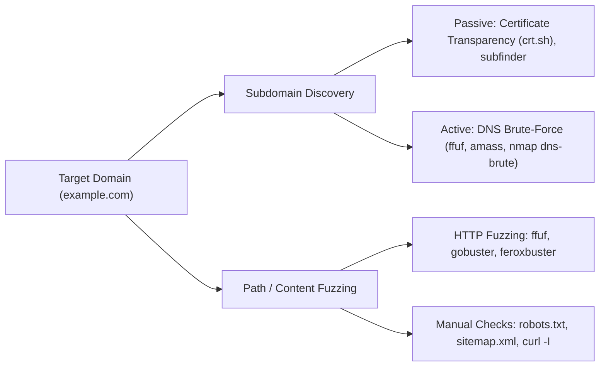

# Finding Subdomains & Hidden Paths

> **TL;DR:** Attackers map an organization's attack surface by discovering **subdomains** (e.g., `dev.target.com`, `staging.target.com`) via passive OSINT/DNS and **hidden web paths/files** (e.g., `/admin`, `/.env`, `/api/v1`) via wordlist fuzzing.

---

## Core Concepts & Mental Model



- **Subdomain vs. Virtual Host (VHost):**
  - **Subdomain:** Has a public DNS record (`dev.example.com` -> `1.2.3.4`).
  - **VHost:** Lives on the same IP as `example.com` and only responds when the HTTP `Host:` header matches, even without a public DNS entry.
- **Directory/Path Fuzzing:** Sends thousands of HTTP requests using a wordlist (e.g., `SecLists/Discovery/Web-Content/`) and filters by status code (`200`, `301`, `403`) or response size.

---

## Quick-Reference Command Cheatsheet

### 1. Subdomain Discovery
| Tool / Command | Purpose & Example |
|----------------|-------------------|
| `subfinder -d example.com -silent` | Fast **passive** subdomain enumeration from public sources |
| `amass enum -passive -d example.com` | Deep passive OSINT subdomain enumeration |
| `curl -s "https://crt.sh/?q=%25.example.com&output=json" \| jq -r '.[].name_value' \| sort -u` | Query Certificate Transparency logs for subdomains |
| `nmap --script dns-brute example.com` | Active DNS subdomain brute-force using Nmap NSE |
| `ffuf -w /usr/share/seclists/Discovery/DNS/subdomains-top1million-5000.txt -u http://example.com -H "Host: FUZZ.example.com" -fs <size>` | Active **VHost** brute-forcing via `Host` header (filter out default response size with `-fs`) |

### 2. Web Path & File Discovery
| Tool / Command | Purpose & Example |
|----------------|-------------------|
| `curl -I http://target.com/robots.txt` | Check HTTP headers/existence of `robots.txt` or specific paths |
| `ffuf -u http://target.com/FUZZ -w /usr/share/seclists/Discovery/Web-Content/common.txt -mc 200,204,301,302,307,401,403` | High-speed directory & file fuzzer (`-mc` matches specific status codes) |
| `gobuster dir -u http://target.com -w /usr/share/wordlists/dirb/common.txt -x php,txt,bak` | Brute-force directories and specific file extensions (`-x`) |
| `feroxbuster -u http://target.com -w /usr/share/seclists/Discovery/Web-Content/raft-medium-directories.txt` | Recursive web content discovery (automatically scans inside found folders) |

---

## Common Pitfalls & Defensive Notes
- **Wildcard DNS & Soft-404s:** Some servers return `200 OK` for every random path ("soft 404"). Always check the baseline response size first and use `-fs <bytes>` in `ffuf` to filter noise.
- **Noisy Scanning:** Aggressive fuzzing (`-t 100` threads) triggers WAF/rate-limiting (`429 Too Many Requests`) and floods server access logs.
- **Defensive Tip:** Remove unused staging/dev DNS records, disable directory listing (`Options -Indexes`), never commit `.git/` or `.env` to web roots, and monitor logs for spikes in `404` responses from a single IP.

---

## Hands-On Lab: Local Content Discovery & Soft-404 Filtering with `ffuf`

**Goal:** Spin up a local test web server with a hidden file and a "soft-404" catch-all, then discover the hidden path using `ffuf` on Kali.

### Step 1: Create a Safe Local Lab Target
```bash
mkdir -p /tmp/fuzz_lab && cd /tmp/fuzz_lab
echo "Public Home Page" > index.html
echo "SECRET_ADMIN_PANEL" > admin.html

# Start Python HTTP server in the background on port 8888
python3 -m http.server 8888 &
SERVER_PID=$!
```

### Step 2: Run `ffuf` Against Your Local Target
```bash
# Create a small test wordlist
printf "login\nimages\nadmin.html\nconfig\nbackup\n" > /tmp/fuzz_lab/words.txt

# Fuzz for paths matching 200 OK
ffuf -u http://127.0.0.1:8888/FUZZ -w /tmp/fuzz_lab/words.txt -mc 200
```
*Teaching Moment:* `ffuf` replaces `FUZZ` with each line in `words.txt`. Only `admin.html` returns `Status: 200`, while the others return `404` and are filtered out by `-mc 200`.

### Step 3: Clean Up
```bash
kill $SERVER_PID
rm -rf /tmp/fuzz_lab
```

---

## Practice & Next Steps
- **Labs:** TryHackMe *Content Discovery*, *Subdomain Enumeration*, *Walking An Application*
- **Next Track:** Start the [Offensive Track (Recon & OSINT)](../offensive/recon_and_osint.md) or [Defensive Track (SOC & Incident Response)](../defensive/soc_and_incident_response.md)
