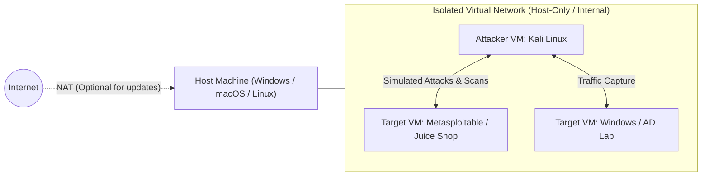

# Lab Setup & Virtualization

> **TL;DR:** Never practice security tools on your daily-driver host OS or public networks. Build an isolated virtual lab using a hypervisor (VirtualBox or VMware), a security distro (Kali Linux), and intentionally vulnerable target VMs on a **Host-Only** or **Internal** network, taking snapshots before every major change.

---

## Core Concepts & Mental Model

A **Type-2 Hypervisor** (VirtualBox, VMware Workstation/Fusion) runs on top of your host OS and lets you spin up isolated virtual machines (VMs) that share a private virtual network.



### Network Modes Explained
| Mode | Internet Access? | Host ↔ VM? | VM ↔ VM? | When to Use |
|------|-----------------|------------|----------|-------------|
| **NAT** | Yes (via host IP) | Port-forward only | No | Updating Kali packages safely |
| **NAT Network** | Yes | Port-forward only | Yes | Multi-VM labs needing outbound internet |
| **Host-Only** | **No** | Yes | Yes | **Recommended** for running vulnerable target VMs safely |
| **Internal Network** | **No** | No | Yes | Strictest isolation (e.g., malware analysis) |
| **Bridged** | Yes (LAN IP) | Yes | Yes | Only when testing physical LAN devices you own |

---

## Quick-Reference Setup & CLI Cheatsheet

### Essential VirtualBox CLI (`VBoxManage`) Commands
| Command | Purpose |
|---------|---------|
| `VBoxManage list vms` | List all registered virtual machines |
| `VBoxManage list runningvms` | List currently running VMs |
| `VBoxManage snapshot "<VM>" take "clean-state"` | Create a snapshot before testing or installing tools |
| `VBoxManage snapshot "<VM>" restore "clean-state"` | Revert a broken or compromised VM back to clean state |
| `VBoxManage startvm "<VM>" --type headless` | Start a target VM in the background without a GUI window |

### Essential Kali Linux Post-Install Commands
| Command | Purpose |
|---------|---------|
| `passwd` | Change the default `kali:kali` password immediately |
| `sudo apt update && sudo apt full-upgrade -y` | Update package lists and upgrade all Kali tools |
| `sudo apt install -y seclists curl jq git rlwrap tmux` | Install essential wordlists (`SecLists`), `rlwrap`, and `tmux` |
| `sudo gzip -d /usr/share/wordlists/rockyou.txt.gz` | Decompress `rockyou.txt` for `ffuf`, `hydra`, `john`, and `hashcat` |
| `kali-tweaks` | Configure Kali shell prompts, metapackages, and hardening options |
| `ip -4 a` | Verify your VM's assigned IP (`eth0` for local lab, `tun0` for VPN labs) |
| `sudo systemctl start ssh` | Start SSH service if accessing Kali from your host terminal |

### Quick Docker-Based Vulnerable Apps (Lightweight Alternative)
| Target App | Command |
|------------|---------|
| **OWASP Juice Shop** | `docker run --rm -p 127.0.0.1:3000:3000 bkimminich/juice-shop` |
| **DVWA** | `docker run --rm -p 127.0.0.1:8080:80 vulnerables/web-dvwa` |

---

## Common Pitfalls & Safety Notes
- **Exposing Vulnerable VMs on Bridged Mode:** Running Metasploitable or DVWA on a Bridged adapter on public/campus Wi-Fi exposes an unpatched machine to everyone on that network. Always use **Host-Only** or **Internal** for vulnerable targets, or bind Docker containers to `127.0.0.1`.
- **Skipping Snapshots:** Always snapshot a fresh VM after updating and before running experiments—especially before malware triage or kernel-level labs.
- **Over-allocating RAM:** Leave at least 4–6 GB of RAM for your host OS so it doesn't freeze when running 2+ VMs simultaneously.

---

## Hands-On Lab: Spin Up Your First Isolated Kali + Vulnerable Target Lab

**Goal:** Launch OWASP Juice Shop locally bound only to `127.0.0.1` (safe isolation) and verify Kali's wordlists and networking.

### Step 1: Prepare Kali & Extract Wordlists
```bash
# Update package index and install core lab utilities
sudo apt update && sudo apt install -y seclists curl jq tmux rlwrap

# Decompress rockyou.txt so password/fuzzing tools can read it
sudo gzip -d /usr/share/wordlists/rockyou.txt.gz
```
*Why this matters:* Many Kali tutorials fail on step 1 because `rockyou.txt` ships compressed as `.gz` and `seclists` isn't installed in the default ISO.

### Step 2: Start a Local Vulnerable Web Target (Docker)
```bash
# Bind ONLY to 127.0.0.1 so no one on your Wi-Fi can access the vulnerable app
docker run -d --name juice-shop -p 127.0.0.1:3000:3000 bkimminich/juice-shop
```
*Why `-p 127.0.0.1:3000:3000`?* Without `127.0.0.1:`, Docker binds to `0.0.0.0`, exposing an intentionally vulnerable app to your entire local network.

### Step 3: Verify Reachability & Clean Up
```bash
# Confirm the app responds with HTTP 200 OK
curl -I http://127.0.0.1:3000

# When finished practicing, stop and remove the container
docker stop juice-shop && docker rm juice-shop
```

---

## Practice & Next Steps
- **Downloadables:** [VirtualBox](https://www.virtualbox.org/), [Kali Linux VMs](https://www.kali.org/get-kali/#kali-virtual-machines), [OWASP Juice Shop](https://owasp.org/www-project-juice-shop/)
- **Next Topic:** [Networking Fundamentals](networking_fundamentals.md)
