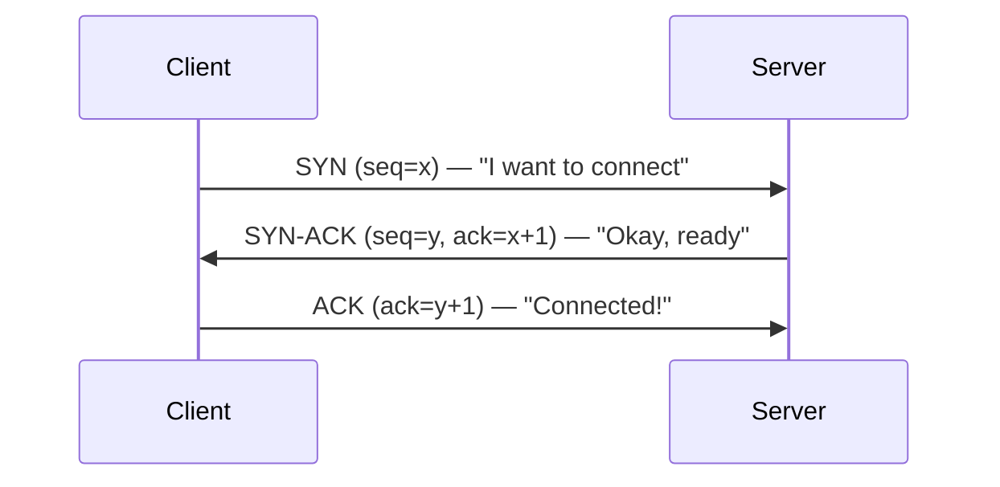

# Networking Fundamentals

> **TL;DR:** Every attack and defense happens over a network. Master the TCP/IP model, CIDR subnetting, the TCP 3-way handshake, common ports/protocols, DNS, and core CLI diagnostics (`ip`, `ss`, `dig`, `nc`, `tcpdump`) before touching offensive or defensive tools.

---

## Core Concepts & Mental Model

### OSI Model vs. TCP/IP Model
| OSI Layer | Name | TCP/IP Layer | Key Protocols / Concepts |
|-----------|------|--------------|--------------------------|
| **7** | Application | Application | HTTP/S, DNS, SSH, FTP, SMB, SMTP |
| **6** | Presentation | Application | TLS/SSL encryption, ASCII, JSON |
| **5** | Session | Application | NetBIOS, RPC, session state |
| **4** | Transport | Transport | **TCP** (reliable, connection-oriented), **UDP** (fast, connectionless), Ports |
| **3** | Network | Internet | **IP** (IPv4/IPv6), **ICMP** (`ping`), Routing |
| **2** | Data Link | Network Access | **MAC addresses**, **ARP**, Ethernet switches, VLANs |
| **1** | Physical | Network Access | Cables, fiber, Wi-Fi radio waves |

### The TCP 3-Way Handshake

*Why it matters:* `nmap -sS` (SYN scan) sends `SYN`, sees `SYN-ACK` (port open) or `RST` (port closed), and sends `RST` instead of completing the handshake.

### CIDR Subnetting Quick Reference
| CIDR | Subnet Mask | Total IPs | Usable Hosts |
|------|-------------|-----------|--------------|
| `/32` | `255.255.255.255` | 1 | 1 (Single host) |
| `/24` | `255.255.255.0` | 256 | 254 |
| `/16` | `255.255.0.0` | 65,536 | 65,534 |
| `/8` | `255.0.0.0` | 16,777,216 | 16,777,214 |

### Essential Ports & Protocols Table
| Port | Proto | Service | Security Relevance |
|------|-------|---------|--------------------|
| `21` | TCP | FTP | Cleartext creds, anonymous login |
| `22` | TCP | SSH | Remote shell, key-based auth, brute-force target |
| `23` | TCP | Telnet | Unencrypted remote shell (legacy/insecure) |
| `25` | TCP | SMTP | Email relay, user enumeration (`VRFY`/`EXPN`) |
| `53` | TCP/UDP | DNS | Domain resolution, zone transfers (`AXFR`) |
| `80` | TCP | HTTP | Unencrypted web traffic |
| `110` / `143` | TCP | POP3 / IMAP | Email retrieval (cleartext unless TLS) |
| `139` / `445` | TCP | NetBIOS / SMB | Windows file sharing, EternalBlue, relay attacks |
| `161` | UDP | SNMP | Network device monitoring, default community strings (`public`) |
| `389` / `636` | TCP | LDAP / LDAPS | Active Directory queries |
| `443` | TCP | HTTPS | Encrypted web traffic (TLS) |
| `3306` | TCP | MySQL | Database access |
| `3389` | TCP | RDP | Windows Remote Desktop |

---

## Quick-Reference Command Cheatsheet

| Tool / Command | Purpose & Example |
|----------------|-------------------|
| `ip a` / `ip r` | Show network interfaces/IPs and routing table |
| `ss -tulnp` | List all listening (`-l`) TCP (`-t`) & UDP (`-u`) ports with numeric output (`-n`) and process names (`-p`) |
| `ping -c 4 10.10.10.5` | Send 4 ICMP Echo requests to check host reachability |
| `traceroute 1.1.1.1` | Trace network hops to a destination (`tracert` on Windows) |
| `dig example.com ANY +short` | Query DNS records for a domain |
| `dig @ns1.target.com target.com axfr` | Attempt a DNS zone transfer against a specific nameserver |
| `arp -a` | View local ARP cache (IP-to-MAC address mappings) |
| `nc -nv 10.10.10.5 80` | Connect to a TCP port manually with Netcat (banner grabbing) |
| `nc -lvnp 4444` | Start a Netcat listener on port `4444` |
| `sudo tcpdump -i eth0 port 80 -nn` | Capture live HTTP traffic on `eth0` without DNS resolution |

---

## Common Pitfalls & Defensive Notes
- **Blocking ICMP ≠ Host Offline:** Many servers drop `ping` (ICMP) packets; a host that doesn't reply to `ping` can still have TCP ports open (`nmap -Pn` skips ping discovery).
- **Private IP Ranges (RFC 1918):** `10.0.0.0/8`, `172.16.0.0/12`, and `192.168.0.0/16` are non-routable on the public internet.
- **Defensive Tip:** Minimize exposed attack surface by auditing listening sockets regularly with `ss -tulnp` (Linux) or `netstat -ano` (Windows) and closing unused ports at the firewall.

---

## Hands-On Lab: Live Port Inspection, Banner Grabbing & Packet Sniffing

**Goal:** Start a local TCP listener, connect to it with Netcat, observe the 3-way handshake with `tcpdump`, and inspect DNS records with `dig`.

### Step 1: Check Listening Ports on Your Machine
```bash
ss -tulnp
```
*What to look for:* `State = LISTEN`, `Local Address:Port` (e.g., `127.0.0.1:53` vs `0.0.0.0:22`), and the owning process name. Services bound to `0.0.0.0` are reachable from the network; `127.0.0.1` is local-only.

### Step 2: Start a Test Server & Capture the TCP Handshake
Open **two** Kali terminal panes (`tmux` -> `Ctrl+B` then `%`):
```bash
# Terminal 1: Start a listener on TCP port 9090
nc -lvnp 9090
```
```bash
# Terminal 2: Capture loopback traffic on port 9090 in the background, then connect
sudo tcpdump -i lo port 9090 -nn -c 6 &
sleep 1
echo "Hello TCP!" | nc -nv 127.0.0.1 9090
```
*Teaching Moment:* In the `tcpdump` output, look at the TCP flags: `[S]` (SYN), `[S.]` (SYN-ACK), `[.]` (ACK), `[P.]` (PSH-ACK carrying `"Hello TCP!"`), and `[F.]` (FIN). You just watched the entire TCP lifecycle live.

### Step 3: Query DNS Records Manually
```bash
dig example.com A +short
dig example.com MX +short
dig example.com TXT +short
```
*Why this matters:* `A` gives the IPv4 address, `MX` reveals mail servers, and `TXT` often exposes third-party SaaS integrations (SPF/DMARC).

---

## Practice & Next Steps
- **Labs:** TryHackMe *Introductory Networking*, *DNS in Detail*, *Packets & Frames*
- **Next Topic:** [Linux & Bash Essentials](linux_and_bash_essentials.md)
