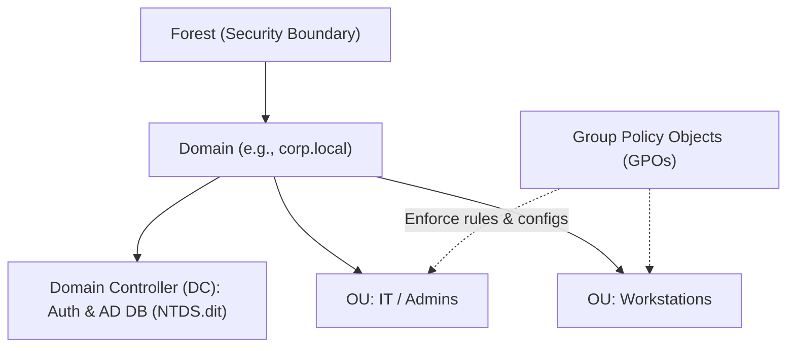

# Windows & Active Directory Basics

> **TL;DR:** Over 80% of enterprise environments run Windows and Active Directory (AD). Understanding Windows architecture (Registry, Services, Event Logs, PowerShell) and AD authentication (Kerberos vs. NTLM, GPOs, OUs) is mandatory for both Red and Blue teams.

---

## Core Concepts & Mental Model

### Windows Core Architecture
- **SAM & LSASS:** Local password hashes live in the **SAM** (Security Account Manager) database; active credentials/tickets in memory are managed by **LSASS** (`lsass.exe`).
- **Registry Hives:** Hierarchical config database (`HKLM` = Local Machine, `HKCU` = Current User). Common persistence keys live under `...\CurrentVersion\Run`.
- **UAC (User Account Control):** Separates standard token from elevated Admin token even for administrator accounts.
- **PowerShell vs. CMD:** PowerShell is object-oriented and built on .NET; it provides deep system visibility (and is heavily logged via Script Block Logging `Event ID 4104`).

### Active Directory (AD) Hierarchy


### Kerberos vs. NTLM Authentication
| Feature | Kerberos (Default in AD) | NTLM (Legacy / Fallback) |
|---------|--------------------------|--------------------------|
| **Mechanism** | Ticket-based (TGT -> TGS) via KDC on Port `88` | Challenge-Response using NTLM hash |
| **Mutual Auth?** | Yes (client & server verify each other) | No |
| **Common Attacks** | Kerberoasting, AS-REP Roasting, Golden/Silver Ticket | Pass-the-Hash (PtH), NTLM Relay |

---

## Quick-Reference Command Cheatsheet

### System & User Enumeration (`cmd` / PowerShell)
| Command | Purpose |
|---------|---------|
| `whoami /all` | Show current user, groups, and **token privileges** (e.g., `SeImpersonatePrivilege`) |
| `systeminfo` | OS version, build number, hotfixes (patches), domain membership |
| `net user` / `net localgroup administrators` | List local users and members of the Administrators group |
| `net user /domain` | List all Active Directory domain users |
| `net group "Domain Admins" /domain` | List members of Domain Admins |
| `ipconfig /all` | Show IP, subnet, gateway, and DNS servers (DC is usually the DNS server) |
| `netstat -ano` | List active connections and listening ports with PIDs |

### Processes, Services & Scheduled Tasks
| Command | Purpose |
|---------|---------|
| `tasklist /svc` | List running processes and associated Windows services |
| `Get-Service \| Where-Object {$_.Status -eq "Running"}` | (PowerShell) List running services |
| `wmic service get name,displayname,pathname,startmode` | Inspect service binary paths (useful for finding unquoted service paths) |
| `schtasks /query /fo LIST /v` | List scheduled tasks and what accounts they run as |

### Event Logs & Defender Inspection (PowerShell)
| Command | Purpose |
|---------|---------|
| `Get-WinEvent -LogName Security -MaxEvents 20` | Read the latest 20 Windows Security Event Logs |
| `Get-MpComputerStatus` | Check Windows Defender status and real-time protection |

---

## Common Pitfalls & Defensive Notes
- **Confusing Local Admin with Domain Admin:** Compromise of a local administrator on one workstation does not automatically grant Domain Admin, unless credentials/sessions for a Domain Admin are cached in memory on that machine.
- **Defensive Tip:** Disable NTLM where possible, enforce **Tiered Administration** (never log into workstations with Domain Admin accounts), and enable **Credential Guard** to protect LSASS.

---

## Hands-On Lab: Local Windows Enumeration & Privilege Check (On a Windows Lab VM)

**Goal:** Run the exact baseline enumeration commands every Red Teamer and Blue Teamer uses when landing on a Windows host.

### Step 1: Identity & Token Privileges Check
```cmd
whoami /all
```
*What to look for:* Under **PRIVILEGES INFORMATION**, check if `SeImpersonatePrivilege` or `SeBackupPrivilege` is listed—these are classic Windows PrivEsc vectors. Under **GROUP INFORMATION**, check for `BUILTIN\Administrators` or custom IT groups.

### Step 2: OS Patch Level & Network Context
```cmd
systeminfo | findstr /B /C:"OS Name" /C:"OS Version" /C:"Domain"
ipconfig /all
```
*Teaching Moment:* `Domain` tells you whether the machine is standalone (`WORKGROUP`) or joined to an Active Directory domain (e.g., `corp.local`). The **DNS Servers** IP in `ipconfig /all` is almost always the Domain Controller!

### Step 3: Inspect Running Services & Scheduled Tasks (PowerShell)
```powershell
# Find running services and their binary paths
Get-CimInstance Win32_Service | Where-Object {$_.State -eq "Running"} | Select-Object Name, PathName, StartName | Format-Table -AutoSize

# Check the last 10 Security logon events (4624 = Success, 4625 = Failed)
Get-WinEvent -FilterHashtable @{LogName='Security'; ID=4624,4625} -MaxEvents 10 | Select-Object TimeCreated, Id, Message
```

---

## Practice & Next Steps
- **Labs:** TryHackMe *Windows Fundamentals 1–3*, *Active Directory Basics*, *Attacktive Directory*
- **Next Topic:** [Web & HTTP Fundamentals](web_and_http_fundamentals.md)
