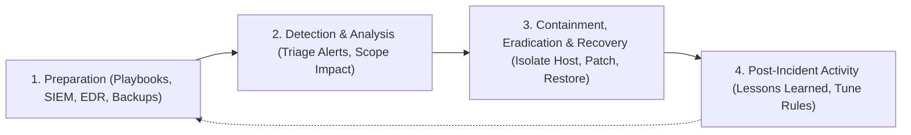

# SOC & Incident Response (Defensive)

> **TL;DR:** A Security Operations Center (SOC) monitors telemetry 24/7 to detect, triage, contain, and eradicate threats. Follow the **NIST Incident Response (IR) Lifecycle**, classify alerts using **True vs. False Positives**, and map attacker behaviors to **MITRE ATT&CK** TTPs.

---

## Core Concepts & Mental Model

### NIST SP 800-61 Incident Response Lifecycle


### Alert Triage Outcomes
| Outcome | Meaning | Action |
|---------|---------|--------|
| **True Positive (TP)** | Confirmed malicious activity | Contain, escalate, open IR ticket |
| **Benign True Positive (BTP)** | Real trigger, but authorized (e.g., scheduled pentest or IT script) | Document & close; optionally tune exception |
| **False Positive (FP)** | Alert fired on normal, non-malicious activity | Close & tune detection rule to reduce alert fatigue |

### IoCs vs. TTPs (Pyramid of Pain)
- **IoCs (Indicators of Compromise):** Atomic artifacts like IP addresses, file hashes (SHA-256), and domain names. *Easy for attackers to change.*
- **TTPs (Tactics, Techniques, & Procedures):** *How* an attacker operates (e.g., MITRE ATT&CK `T1059.001` PowerShell Execution, `T1003` OS Credential Dumping). *Harder for attackers to change—focus detections here.*

---

## Quick-Reference Triage & Threat Intel Cheatsheet

### Initial Alert Triage Checklist (The 5 W's)
1. **Who:** Which user account (`svc_`, `admin`, standard user) and host?
2. **What:** What process/binary, parent process (`cmd.exe` spawned by `winword.exe`?), or network connection triggered it?
3. **When:** Timestamp in UTC; did it happen outside business hours?
4. **Where:** Source IP/country, destination IP/port, internal vs. external?
5. **Why / Context:** Is there a known change ticket, IT automation, or repeated pattern across other hosts?

### Threat Intel & Enrichment Quick Links / CLI
| Tool / Source | Purpose |
|---------------|---------|
| `whois <ip_or_domain>` / `dig +short <domain>` | Check domain age, registrar, and ASN ownership |
| `curl -s https://ipinfo.io/<IP>` | Quick geolocation, ASN, and ISP lookup for suspicious IPs |
| **VirusTotal / MalwareBazaar** | Check file hashes (SHA-256), URLs, and domains (never upload confidential company files!) |
| **AbuseIPDB / GreyNoise** | Check if an IP is a known internet-wide scanner vs. targeted attacker |

---

## Common Pitfalls & Defensive Notes
- **Containment Before Preservation:** Immediately wiping or rebooting a compromised host destroys volatile memory (RAM) evidence. Always **network-isolate** via EDR/firewall first, then capture triage artifacts before remediation.
- **Uploading Sensitive Docs to VirusTotal:** Public VirusTotal uploads can be downloaded by paid subscribers. Only search **hashes**, never upload internal documents or scripts.

---

## Hands-On Lab: Simulated SOC Alert Enrichment from Kali CLI

**Goal:** Practice enriching a suspicious IP and file hash using safe, read-only OSINT lookups from Kali—without touching the attacker's server directly.

### Step 1: Enrich a Suspicious IP (ASN, Geo, Ownership)
```bash
# Test with Cloudflare DNS IP (1.1.1.1) or any public IP from an alert
TARGET_IP="1.1.1.1"
curl -s "https://ipinfo.io/${TARGET_IP}/json" | jq .
whois "$TARGET_IP" | grep -iE "NetName|OrgName|Country|CIDR"
```
*Teaching Moment:* Checking ASN/OrgName immediately tells you whether an IP belongs to a residential ISP, a VPS provider (DigitalOcean/AWS — common for C2), or a legitimate CDN.

### Step 2: Hash a Suspect File Without Executing It
```bash
echo "simulated_payload" > /tmp/suspect.bin
sha256sum /tmp/suspect.bin
```
*Workflow:* Copy only the `sha256sum` string and search it on **VirusTotal** or **MalwareBazaar**—never upload internal files directly. Clean up with `rm /tmp/suspect.bin`.

---

## Practice & Next Steps
- **Labs:** [LetsDefend](https://letsdefend.io/) (*SOC Analyst Path*), TryHackMe *SOC Level 1*
- **Next Topic:** [Network Monitoring & Wireshark](network_monitoring_wireshark.md)
