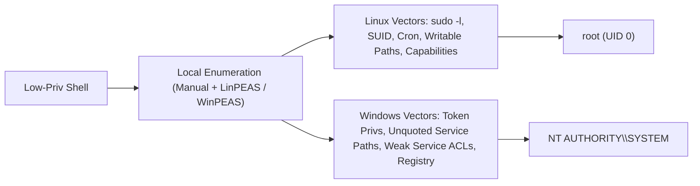

# Privilege Escalation (Offensive)

> **TL;DR:** Initial access usually lands you as a low-privilege user (`www-data`, `svc_web`). Privilege Escalation ("PrivEsc") is enumerating local misconfigurations—`sudo` rules, SUID binaries, cron jobs, weak service permissions, or token privileges—to become `root` (Linux) or `NT AUTHORITY\SYSTEM` (Windows).

---

## Core Concepts & Mental Model



---

## Quick-Reference Command Cheatsheet

### 1. Linux Privilege Escalation
| Check / Vector | Command & What to Look For |
|----------------|----------------------------|
| **Sudo Permissions** | `sudo -l` — Check if you can run binaries (e.g., `vim`, `find`, `python3`) as `root` -> look up on **[GTFOBins](https://gtfobins.github.io/)** |
| **SUID Binaries** | `find / -perm -4000 -type f 2>/dev/null` — Non-standard binaries owned by `root` with SUID bit |
| **Capabilities** | `getcap -r / 2>/dev/null` — Look for `cap_setuid+ep` on binaries like `python3` or `perl` |
| **Cron Jobs** | `cat /etc/crontab` & `ls -la /etc/cron*` — Scripts run by `root` that are writable by your user |
| **Writable `/etc/passwd`** | `ls -la /etc/passwd` — If writable, you can add a new `root` UID `0` user |
| **Automated Enum** | `./linpeas.sh \| tee linpeas.txt` — Highlights high-probability vectors in red/yellow |

### 2. Windows Privilege Escalation
| Check / Vector | Command & What to Look For |
|----------------|----------------------------|
| **Token Privileges** | `whoami /priv` — Look for `SeImpersonatePrivilege` or `SeAssignPrimaryTokenPrivilege` (Potato attacks: PrintSpoofer / GodPotato) |
| **Unquoted Service Paths** | `wmic service get name,displayname,pathname,startmode \| findstr /i "auto" \| findstr /i /v "c:\windows\\"` — Paths with spaces lacking quotes |
| **Scheduled Tasks** | `schtasks /query /fo LIST /v` — Tasks running as `SYSTEM` pointing to writable scripts/binaries |
| **AlwaysInstallElevated** | `reg query HKLM\SOFTWARE\Policies\Microsoft\Windows\Installer /v AlwaysInstallElevated` — If `0x1`, any `.msi` installs as `SYSTEM` |
| **Stored Credentials** | `cmdkey /list` — Check for saved credentials usable with `runas /savecred` |
| **Automated Enum** | `.\winpeas.exe` — Automated Windows PrivEsc enumeration |

---

## Common Pitfalls & Defensive Notes
- **Running `linpeas`/`winpeas` Without Thinking:** Automated scripts produce a wall of output. Always run quick manual checks (`sudo -l`, `whoami /priv`, `id`, `systeminfo`) first.
- **Defensive Tip:** Follow **Least Privilege** strictly—never grant `NOPASSWD` `sudo` on interpreters/editors, quote all Windows service binary paths, remove unnecessary `SeImpersonatePrivilege` from service accounts, and patch kernel/OS vulnerabilities promptly.

---

## Hands-On Lab: Local Linux PrivEsc Enumeration Checklist on Kali

**Goal:** Practice the exact 60-second manual PrivEsc triage sequence on any Linux box, then run `linpeas.sh` and read its output.

### Step 1: Run the 60-Second Manual Triage Sequence
```bash
# 1. Who am I, and what groups am I in? (docker, lxd, adm, sudo?)
id

# 2. What can I run with sudo?
sudo -l

# 3. Are there custom SUID binaries?
find / -perm -4000 -type f 2>/dev/null

# 4. Are there binaries with Linux capabilities (e.g., cap_setuid)?
getcap -r / 2>/dev/null

# 5. Are there scheduled root cron jobs?
cat /etc/crontab
```

### Step 2: Stage & Run `linpeas.sh` from Kali
```bash
# Install PEASS-ng on Kali if not present
sudo apt install -y peass

# Host /usr/share/peass/linpeas/ on port 8000
python3 -m http.server 8000 --directory /usr/share/peass/linpeas/
```
In a second terminal (simulating a target box), download and run it:
```bash
curl -s http://127.0.0.1:8000/linpeas.sh | sh | head -n 60
```
*Teaching Moment:* Always look for **Red/Yellow** highlighted lines first—those represent near-certain privilege escalation paths.

---

## Practice & Next Steps
- **Labs:** TryHackMe *Linux PrivEsc*, *Windows PrivEsc*, *Jr Penetration Tester* path
- **Cross-Track:** Explore how defenders catch these techniques in the [Defensive Track](../defensive/soc_and_incident_response.md)
