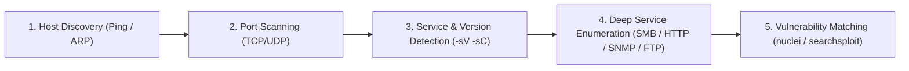

# Scanning & Enumeration (Offensive)

> **TL;DR:** Scanning identifies **live hosts and open ports**; Enumeration extracts **specific details** (service versions, SMB shares, usernames, SNMP data, web endpoints) to find an entry point. `nmap` is your Swiss Army knife here.

---

## Core Concepts & Mental Model



- **Port States in Nmap:**
  - `open`: Application is actively accepting connections.
  - `closed`: Host responded (`RST`), no service listening.
  - `filtered`: Firewall/packet filter dropped the probe (no response or ICMP unreachable).

---

## Quick-Reference Command Cheatsheet

### 1. Nmap Essential Scans
| Command | Purpose |
|---------|---------|
| `nmap -sn 10.10.10.0/24` | Ping sweep (host discovery only, no port scan) |
| `nmap -sS -p- --min-rate 2000 -oA full_tcp 10.10.10.5` | Fast TCP SYN scan of all 65,535 ports, saving all output formats (`-oA`) |
| `nmap -sC -sV -p 22,80,445 10.10.10.5` | Run default NSE scripts (`-sC`) and version detection (`-sV`) on open ports |
| `nmap -sU --top-ports 50 10.10.10.5` | Scan top 50 UDP ports (DNS `53`, SNMP `161`, TFTP `69`) |
| `nmap -Pn -sT 10.10.10.5` | Skip host discovery (`-Pn`) and use TCP Connect scan (`-sT`, no root needed) |

### 2. Service-Specific Enumeration
| Service (Port) | Command & Purpose |
|----------------|-------------------|
| **SMB (139/445)** | `smbclient -L //10.10.10.5 -N` — List SMB shares with null session |
| **SMB (139/445)** | `enum4linux-ng -A 10.10.10.5` — Automated SMB/RPC user, share, and policy enum |
| **SNMP (161/UDP)** | `snmpwalk -v2c -c public 10.10.10.5` — Dump SNMP MIB tree using `public` community string |
| **FTP (21)** | `ftp 10.10.10.5` (try user `anonymous` / empty pass) |
| **NFS (2049)** | `showmount -e 10.10.10.5` — List exported NFS shares |
| **Web (80/443)** | `nuclei -u https://target.com -severity medium,high,critical` — Template-based vulnerability scan |
| **Web (80/443)** | `nikto -h http://target.com` — Classic web server misconfiguration & dangerous file scanner |

---

## Common Pitfalls & Defensive Notes
- **Scanning Only Top 1000 Ports:** Non-standard services often hide on high ports (e.g., `8080`, `8443`, `50000`). Always run a fast `-p-` scan in the background while enumerating initial ports.
- **Forgetting UDP:** SNMP (`161`) and TFTP (`69`) are UDP-only and frequently reveal credentials or configs.
- **Defensive Tip:** Port scans generate rapid `SYN` packets across sequential/random ports—easily detected by IDS/IPS (Suricata/Snort) and host firewalls. Disable anonymous FTP/SMB null sessions and change default SNMP community strings.

---

## Hands-On Lab: 2-Step Nmap Scan & Service Enumeration on Localhost / Lab Target

**Goal:** Practice the exact 2-step Nmap methodology (`-p-` discovery -> `-sC -sV` targeted enum) against your local Kali/Docker lab target (`127.0.0.1` or `<TARGET_IP>`).

### Step 1: Start a Local Test Service (Or Use Your Lab VM IP)
```bash
# Optional: spin up a local Nginx test container bound to 127.0.0.1:8080
docker run -d --name web-lab -p 127.0.0.1:8080:80 nginx:alpine
```

### Step 2: Fast Port Discovery (`-p-`)
```bash
mkdir -p /tmp/nmap_lab && cd /tmp/nmap_lab
sudo nmap -sS -p 1-10000 --min-rate 2000 -Pn -oA discovery 127.0.0.1
```
*Why `-oA discovery`?* It saves `.nmap` (human-readable), `.gnmap` (greppable), and `.xml` (importable into Metasploit/reporting tools) all at once.

### Step 3: Deep Enumeration (`-sC -sV`) on Discovered Ports Only
```bash
sudo nmap -sC -sV -p 8080 -oA detailed 127.0.0.1
cat detailed.nmap
```
*Teaching Moment:* `-sV` fingerprints `nginx` and its exact version; `-sC` runs default NSE scripts like `http-title` and `http-server-header`.

### Step 4: Clean Up
```bash
docker stop web-lab && docker rm web-lab
rm -rf /tmp/nmap_lab
```

---

## Practice & Next Steps
- **Labs:** TryHackMe *Nmap*, *Network Services 1 & 2*
- **Next Topic:** [Web App Hacking (OWASP Top 10)](web_app_hacking_owasp.md)
